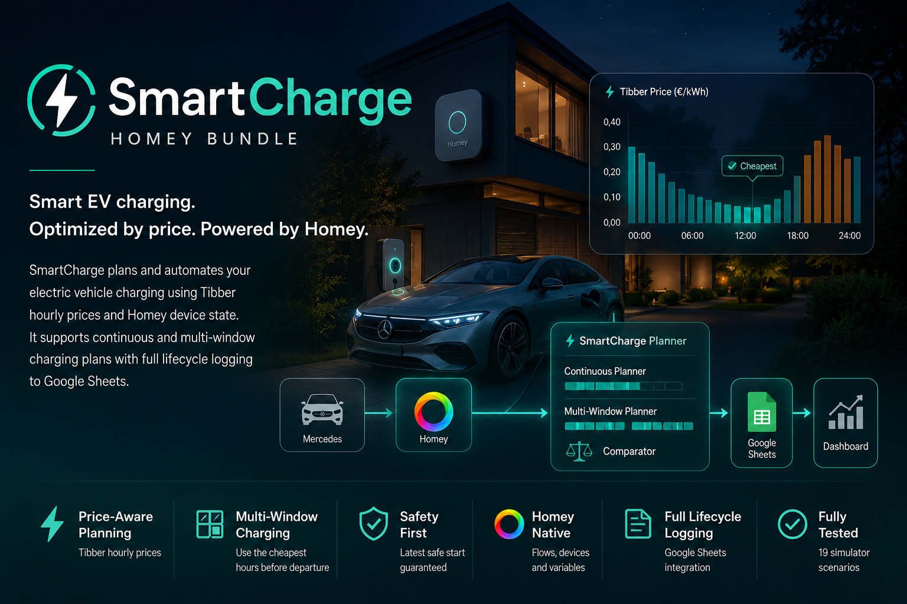

# SmartCharge Homey Bundle

<p align="center">
  
</p>

[](https://nodejs.org/)
[](docs/DevelopmentWorkflow.md)
[](https://homey.app/en-us/app/com.athom.homeyscript/HomeyScript/)
[](https://developer.tibber.com/)
[](docs/GoogleSheetsSetup.md)
[](docs/Simulator.md)
[](#features)
[](LICENSE)

SmartCharge Homey Bundle is a production-tested HomeyScript project for smart
Mercedes EV charging with Homey, Tibber hourly prices, Google Sheets analytics,
and a live public dashboard.

It decides when charging should start, compares continuous and multi-window
charging plans, and keeps the logic testable outside Homey through a local
simulator.

Version 0.6.3 is prepared for local release review. Its manual lifecycle changes
have not been deployed or validated on real Homey. Follow the migration in
`docs/HomeyFlows.md`; strict execution serialization remains a separate task
described in `docs/HomeyExecutionSerialization.md`. The Russian deployment and
rollback checklist is in [HomeyDeploymentReadiness.ru.md](docs/HomeyDeploymentReadiness.ru.md).

## Features

- Production-tested Homey flow lifecycle.
- Local simulator with 94 passing scenarios.
- Multi-window planner for separated low-price slots.
- Google Sheets event logging and analytics.
- Live public dashboard.
- Tibber hourly price integration.
- HomeyScript runtime for Homey Flows.
- Mercedes battery state through Homey device integration.
- Continuous charging planner.
- Safety fallback when the latest safe start is reached.

## Architecture

```text
Mercedes EV
  |
Homey + Homey Flows
  |
SmartCharge HomeyScripts
  |-- Session lifecycle
  |-- Decision engine
  |-- Continuous planner
  |-- Multi-window planner
  `-- Google Sheets logger
  |
Google Sheets
  |-- Events
  |-- Sessions
  |-- Statistics
  `-- Dashboard
```

## Dashboard

Public dashboard:
[SmartCharge Google Sheets dashboard](https://docs.google.com/spreadsheets/d/1LueN5IylHuwcnuLIB12EAuqa7fByK7iZOU74kFAOX6c/edit?usp=sharing)

Only filtered or aggregated dashboard data should be public. Raw event logs,
session IDs, exact arrival/departure patterns, sheet IDs, webhook URLs, and
tokens must stay private.

## Installation

```bash
npm install
npm test
npm run build:homey
```

Generated HomeyScript files are written to `dist/` and copied into Homey as
separate scripts. Full setup is documented in
[docs/Installation.md](docs/Installation.md).

## Simulator

The local simulator runs the real SmartCharge flow entrypoints without Homey. It
uses Homey mocks, Tibber price fixtures, fixed scenario time, and local log
capture.

```bash
npm test
npm run simulate -- overnight
```

Current coverage: 93 passing scenarios, including estimated-cost,
multi-window planner, session lifecycle, safety fallback, and logger payload
validation.

See [docs/Simulator.md](docs/Simulator.md).

## Developer Commands

```bash
npm run lint
npm run lint:fix
npm run format
npm run format:check
npm run verify
```

- `lint` checks the repository with ESLint.
- `lint:fix` applies safe ESLint fixes.
- `format` formats supported files with Prettier.
- `format:check` verifies formatting without changing files.
- `verify` runs lint, formatting checks, tests, simulator scenarios, Apps Script
  materializer tests, and the Homey build.

## Documentation

- [Installation](docs/Installation.md)
- [Homey Flow Setup](docs/HomeyFlows.md)
- [Google Sheets Setup](docs/GoogleSheetsSetup.md)
- [Data Model](docs/DataModel.md)
- [Dashboard Architecture](docs/Dashboard.md)
- [Public Dashboard](docs/PublicDashboard.md)
- [Privacy And Public Release Safety](docs/Privacy.md)
- [Simulator](docs/Simulator.md)
- [Telemetry v2 Milestone](docs/milestones/TelemetryV2.md)
- [ChargePlan Contract](docs/ChargePlan.md)
- [Development Workflow](docs/DevelopmentWorkflow.md)
- [Roadmap](docs/Roadmap.md)
- [Changelog](CHANGELOG.md)
- [License](LICENSE)

## Roadmap

Completed:

- Multi-window charging planner.
- `selectChargePlan()` planner API.
- 93 passing simulator scenarios.
- Public setup docs and privacy guidance.

Next:

- Planner stability rules.
- Dashboard and analytics improvements.
- Energy and cost model refinements.

See [docs/Roadmap.md](docs/Roadmap.md).
